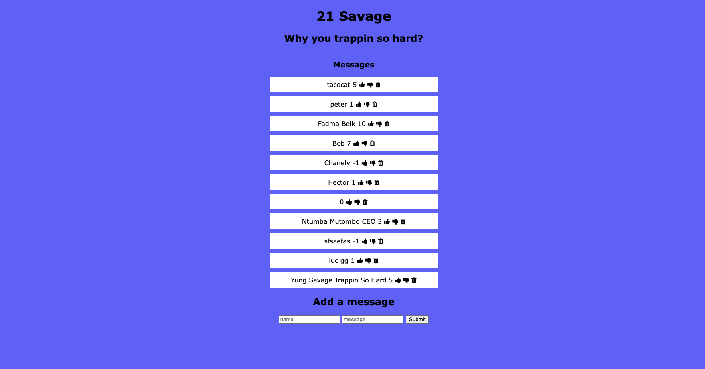

# 21 Savage Likes & Comments

A full-stack message board. Users can post messages, read what others have posted, like or dislike messages, and delete them.

[Try out 21 Savage Likes & Comments here!](https://demo-savage.onrender.com)

## Preview

## Features

- Post a message with your name
- Read messages from other users
- Like and dislike messages
- Delete messages

## 🛠️ Built With

- HTML, CSS and JavaScript
- Node.js and Express
- EJS templates
- MongoDB

## How to Run

1. Clone the repo
2. Run `npm install`
3. Run `npm run savage`
4. Navigate to `localhost:3000`

## 📚 What I Learned

- How to build a CRUD app with Express using GET, POST, PUT and DELETE routes
- How to store, update and delete data in MongoDB
- How to render data into a page with EJS templates
- How to use `fetch` in front-end JavaScript to send PUT and DELETE requests, since HTML forms only support GET and POST
